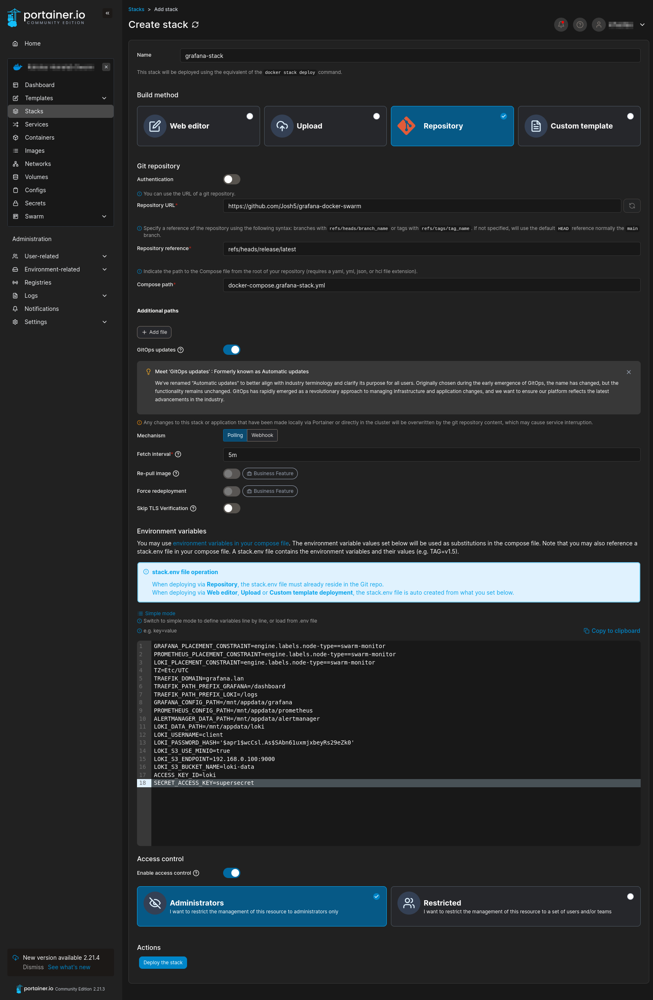

# Docker Swarm Stack Setup

## Choose a template

| Template                                                                                               | Purpose                                                 |
| :----------------------------------------------------------------------------------------------------- | :------------------------------------------------------ |
| [docker-compose.grafana-stack.yml](./docker-compose.grafana-stack.yml)                                 | Central Grafana, Prometheus and Loki services.          |
| [docker-compose.minio.yml](./docker-compose.minio.yml)                                                 | MinIO object storage for Loki.                          |
| [docker-compose.node-metrics-collection-stack.yml](./docker-compose.node-metrics-collection-stack.yml) | Collect host and container metrics on each node.        |
| [docker-compose.vmagent-edge-relay.yml](./docker-compose.vmagent-edge-relay.yml)                       | Receive and forward metrics through a vmagent relay.    |
| [docker-compose.prometheus-edge-relay.yml](./docker-compose.prometheus-edge-relay.yml)                 | Receive and forward metrics through a Prometheus relay. |

Deploy the central stack first, then configure collectors to send metrics directly to its receiver or through one of the edge relay templates. If Loki uses MinIO, prepare its bucket and credentials using the [MinIO setup guide](./docs/minio.md).

## Deploy with Portainer

1. Prepare the external networks and host directories required by the chosen YAML, following its setup instructions.
2. In your Swarm environment, add a stack and select **Repository** as the build method. Name it after the chosen template, for example `vmagent-edge-relay`.
3. Set **Repository URL** to `<url>` and **Repository reference** to `refs/heads/<branch>`.
4. Set **Compose path** to the YAML filename, for example `docker-compose.vmagent-edge-relay.yml`.
5. Open the matching `.env.example` alongside that YAML on the release branch. For example, use [docker-compose.vmagent-edge-relay.env.example](<url>/blob/<branch>/docker-compose.vmagent-edge-relay.env.example). Copy its contents into **Environment variables → Advanced mode**, then enter your deployment values. Option descriptions and defaults come from the YAML header.
6. Enable GitOps polling updates with an interval of `5m`, then deploy the stack.

The publish action generates `<YAML filename without .yml>.env.example` from the header between `<config_start>` and `<config_end>`. These files are published on `<branch>`; they are generated artifacts and need not exist in the source directory.



## Deploy with standalone Docker Compose

For standalone node metrics collection, include the override below after the base template. For Swarm, use only the base template; Portainer rejects the standalone CPU settings.

| Base template                                                                                          | Standalone override                                                                                                                              |
| :----------------------------------------------------------------------------------------------------- | :----------------------------------------------------------------------------------------------------------------------------------------------- |
| [docker-compose.node-metrics-collection-stack.yml](./docker-compose.node-metrics-collection-stack.yml) | [overrides/docker-compose.node-metrics-collection-stack.standalone.yml](./overrides/docker-compose.node-metrics-collection-stack.standalone.yml) |

Adjust `PROM_AGENT_CPU_LIMIT`, `NODE_EXPORTER_CPU_LIMIT` and `CADVISOR_CPU_LIMIT` in your environment to change each collector's CPU limit (default: `0.20` cores each). The override also gives collectors lower CPU priority when the host is busy.

Unraid icons and WebUI links are included. To use the vmagent and cAdvisor links, add host port mappings for container ports `8429` and `8080` in your local Compose configuration; these ports are not published by default.

The other templates need no CPU override. Before deploying, prepare the required external networks and host directories. Standalone Compose runs on the local host.

From the repository root, prepare `docker-swarm-templates/node-metrics-collection-stack.env` using the base template's configuration header, including `METRICS_REMOTE_WRITE_URL`, then run:

```bash
docker compose \
    --env-file ./docker-swarm-templates/node-metrics-collection-stack.env \
    -f ./docker-swarm-templates/docker-compose.node-metrics-collection-stack.yml \
    -f ./docker-swarm-templates/overrides/docker-compose.node-metrics-collection-stack.standalone.yml \
    up -d
```

On the release branch, templates are at the repository root: omit `docker-swarm-templates/` from these paths. Use the same files and environment values for subsequent Compose commands, including `config`, `up` and `down`.

For **Portainer on a Docker Standalone environment**, select **Repository** and set:

| Setting                     | Release branch value                                                    |
| :-------------------------- | :---------------------------------------------------------------------- |
| Compose path                | `docker-compose.node-metrics-collection-stack.yml`                      |
| Additional paths → Add file | `overrides/docker-compose.node-metrics-collection-stack.standalone.yml` |

For a source branch, prefix both paths with `docker-swarm-templates/`. Load your environment variables and deploy. Include the override explicitly in **Additional paths**. For Web editor or Upload deployments, merge the override into the base YAML before submitting it.

## Edge relay setup

For vmagent, Docker creates the `vmagent-edge-relay-data` queue volume automatically. Pin placement to the node holding that volume; no `EDGE_VM_DATA_PATH` or host ownership setup is required. The default configuration scrapes the relay itself.

When replacing a relay, stop the old Swarm service before reusing its published port. Keep the collector destination and receiver credentials consistent, and update any proxy to the new service and internal port.

See [edge relay operation](./docs/edge-relays.md) for tuning, recovery and custom scrape configurations, and [metrics delivery alerts](<url>/blob/master/grafana_alert_rules/README.md) to monitor ingestion and forwarding.
